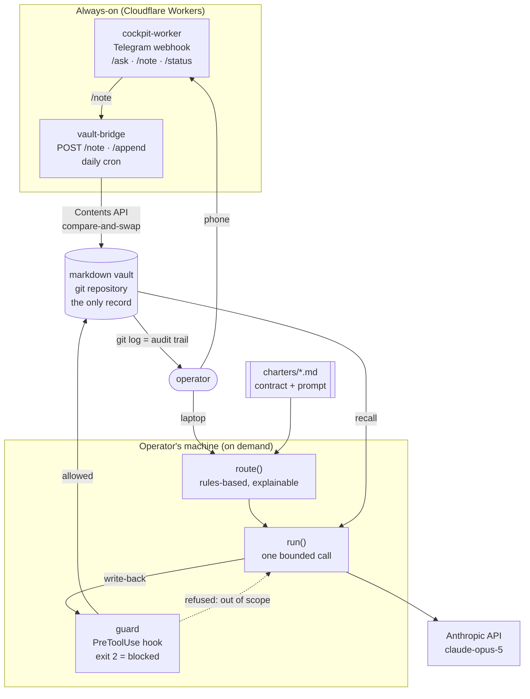

# amagna-intelligence

[](https://github.com/gladkiandrew/amagna-intelligence/actions/workflows/ci.yml)

**A reference architecture for running an AI-native operation: markdown memory,
chartered agents, and a chat cockpit on Cloudflare.**

I ran a marketing agency with a crew of AI agents doing the operational work —
drafting, analytics, outreach research, memory consolidation — coordinated through a
markdown vault and reachable from my phone. This repository is the public, sanitized
version of that architecture: the structure, the engineering decisions, and working
code for every layer. The production prompts, client data, and live integrations are
private and stay private.

```bash
npm install && npm run demo    # runs end to end with no API key
```

---

## Architecture



Five packages, one example, one rule — **the markdown vault is the only place truth
lives.**

| Package | What it does |
|---|---|
| [`packages/memory`](packages/memory) | Loads a folder of markdown notes, indexes them, searches with IDF + recency decay, writes back without disturbing frontmatter. |
| [`packages/agents`](packages/agents) | Parses charters, routes tasks by declared capability, runs one bounded call against the Anthropic API. Mock mode by default. |
| [`packages/guard`](packages/guard) | A `PreToolUse` hook that turns each charter's declared write scope into an enforced one. Exit 2 blocks the write. |
| [`packages/vault-bridge`](packages/vault-bridge) | Cloudflare Worker that commits notes to a Git-backed vault, with compare-and-swap against concurrent writers. |
| [`packages/cockpit-worker`](packages/cockpit-worker) | Cloudflare Worker: Telegram webhook, secret-token auth, chat allowlist, three commands. |
| [`examples/deal-screener`](examples/deal-screener) | A private-equity screening memo. Deterministic TypeScript for every figure; the model writes one paragraph. |

Full walkthrough in [`docs/architecture.md`](docs/architecture.md). The crew and how
routing decides: [`docs/agents.md`](docs/agents.md).

---

## The three decisions that matter

Eight ADRs are in [`docs/decisions/`](docs/decisions). These three carry the most
weight:

**Markdown files are the memory layer, not a database.** The deciding constraint was
not retrieval quality — it was that the operator has to be able to read and correct
what the system believes, by hand, every day, without a tool. If they can't see it,
they can't catch it being wrong, and in practice they stop looking. The cost is
keyword-grade recall and no cross-file transactions. `buildIndex`/`search` is the seam
where embeddings would go.
→ [ADR 1](docs/decisions/0001-markdown-memory-not-a-database.md)

**Charters are prompts with contracts, not autonomous processes.** Autonomy was tried
in its mild form — scheduled runs choosing their own work. The failure wasn't
dramatic; it was that nobody could answer *why did it do that?*, and once that's true
the output stops being trusted. So a run is one bounded call, routing is rules-based,
and nothing publishes.
→ [ADR 4](docs/decisions/0004-charters-not-autonomous-agents.md)

**The write-scope guard fails open.** It sits in front of every file write in the
system, so a bug in it would halt everything rather than protect anything. A payload
it can't parse is a payload it can't attribute to an agent — there's no claim to
enforce. What it does hold absolutely: a write it *can* attribute and that *is* out of
scope never gets through. That makes it a correctness guard, not a security boundary,
and the ADR says so.
→ [ADR 5](docs/decisions/0005-write-scope-guard-fails-open.md)

---

## What's real and what's reference

Being precise about this, because a showcase repo that implies more than it is isn't
worth reading.

**Real, and ported close to as-is.** The compare-and-swap commit loop in
`packages/vault-bridge/src/github.ts` and the constant-time auth beside it run in
production. So does the write-scope guard — `packages/guard` is a close port of a hook
that has refused real out-of-scope writes.

**Real in shape, rewritten here.** The memory layer and the charter/router/runner
pipeline match the production design. The production vault is around 900 notes with
per-folder convention files; the real charters are long and specific, and they are the
proprietary part. The three in `charters/examples/` were written fresh for this repo.

**Written fresh for this repo.** `packages/cockpit-worker` — the live cockpit is a
relay on a VPS, not a Cloudflare Worker, so this is a different implementation of the
same discipline rather than a port. And `examples/deal-screener` doesn't exist in the
original at all. I built it while teaching myself how private-equity deal teams screen
companies, to apply the deterministic-math/model-narrative split on a domain that isn't
marketing. Every company, customer and figure in it is fictional.

**Not here, and won't be.** Production charters. Client names and data. Real account
IDs, zone IDs, bucket names, routes, tokens. The CRM and analytics ingestion plugins.
Any git history from the private repos — this repo starts at its own first commit.

---

## Quickstart

Requires Node 20+. No API key, no network, no configuration.

```bash
npm install
npm run demo
```

The demo runs seven stages: load the vault → recall against it → load the crew →
route four tasks → run each one → enforce write scopes (including a refusal and a
blocked path-traversal attempt) → screen a deal.

```
 4. Routing — rules-based, deterministic, explainable
──────────────────────────────────────────────────────────────────────────────
   "Draft a short post about why we hold the pricing floor"
      → scribe  —  capability "drafting" matched draft
   "Consolidate this week's logs into notes worth keeping"
      → ledger  —  keyword "notes" matched note
   "What are my priorities today?"
      → atlas  —  keyword "priorities" matched prioriti
   "The office printer is jammed again"
      → atlas  —  no capability matched; the coordinator holds unrouted work

 6. Write-scope guard — the charter as an enforced boundary
──────────────────────────────────────────────────────────────────────────────
   ALLOW  scribe → /demo-vault/drafts/pricing-post.md
   BLOCK  scribe → /demo-vault/notes/pricing-floor.md
   BLOCK  scribe → /demo-vault/drafts/../notes/pricing-floor.md
   ALLOW  ledger → /demo-vault/notes/pricing-floor.md
   ALLOW  unlisted-helper → /anywhere/at/all.md
```

Other commands:

```bash
npm test          # 244 tests
npm run verify    # lint + typecheck + test
npm run screen    # print the full deal-screener memo
npm run pipeline  # screen and rank five fictional teasers against a mandate
```

To run the agent stages against a real model, set `ANTHROPIC_API_KEY`. Nothing else
changes — mock mode is a transport swap, not a code path threaded through the logic.

---

## The deal screener

**Why I built it.** I was learning how private-equity business development works:
how a deal team reads a teaser, normalises EBITDA, sizes a paper LBO and decides in
minutes whether a company deserves a call. My thesis is that AI belongs on that front
end of the funnel, doing the reading and the arithmetic so people spend their time on
judgement and relationships. So I built the screen I was learning to do by hand. It has
not been run on a real deal; every company and number below is fictional.

**Where it applies.** The same workflow sits at the top of the funnel for:

- **Lower-middle-market PE funds and their BD teams** triaging inbound banker teasers
- **Search funds** reading dozens of small businesses to buy one
- **Independent sponsors** who must justify every add-back to a capital partner
- **Private credit lenders** sizing debt off normalised EBITDA
- **M&A advisors and family offices** pressure-testing a seller's adjusted figures
  before going to market

Each of those buyers believes different add-backs and pays different multiples, which
is why the thresholds, multiples, LBO assumptions and add-back policy now live in a
[mandate file](examples/deal-screener/mandates) rather than in code.

A worked example on a domain with real stakes for getting numbers wrong. It takes a
teaser — fictional "Project Palm", $18m revenue, $2.4m reported EBITDA — and produces
a screening memo.

**Every figure is computed in TypeScript. The model writes one paragraph.** It's
handed a fact sheet of computed values with no instruction to calculate anything, and
its charter forbids producing a figure that isn't already in that context. The memo
labels which section it wrote. A committed `expected-memo.md` is compared byte for
byte in CI, which is only possible because the pipeline is deterministic.

The interesting part is the add-back review, because that's where a screen earns its
keep. A seller's "adjusted EBITDA" is an argument, not a fact:

| Adjustment | Claimed | Verdict | Credited |
|---|---|---|---|
| Owner compensation above market replacement | $420,000 | Accept | $420,000 |
| Personal expenses run through the company *(undocumented)* | $95,000 | Reject | $0 |
| One-time settlement of a 2024 employment claim | $140,000 | Accept | $140,000 |
| Yard leased from an owner-affiliated LLC below market | -$125,000 | Accept | -$125,000 |
| Annualised run-rate of a contract signed in month 10 | $300,000 | Challenge (50%) | $150,000 |
| Change in policy capitalising fleet repairs | $85,000 | Reject | $0 |
| Route density savings available to a regional acquirer | $220,000 | Reject | $0 |
| **Total** | **$1,135,000** | | **$585,000** |

Two of those rows are the point:

- **Pro-forma synergies are credited at zero.** They belong in the buyer's model, not
  the seller's EBITDA. Crediting them means paying the seller a multiple, in cash at
  close, for work the buyer has to do afterwards.
- **The below-market related-party rent flows through as a negative.** The owner rents
  the yard to their own company at $60k against a $185k appraisal, so reported EBITDA
  is $125k higher than a buyer can reproduce at the rent they'll actually pay.
  Normalisation runs in both directions.

So reported EBITDA of $2.4m becomes **$2.985m buyer-adjusted**, against the seller's
$3.535m. Then:

```
Valuation      $14.9m – $20.9m at 5.0x–7.0x on buyer-adjusted EBITDA
Seller's ask   $21.2m — which is 7.1x of buyer-adjusted, above the top of the range
Paper LBO      6.0x entry, $9.0m debt, $9.3m equity
               → 2.30x MOIC · 18.1% IRR over 5 years, exit at entry multiple
Verdict        Pursue, with the watch items answered first
```

And the model-written paragraph, from the keyless run:

> This is an add-back argument, not a valuation argument: the seller's ask of $21.2m
> is 7.1x of the EBITDA a buyer can actually underwrite, against a 5.0x–7.0x range.
> […] The fact most likely to change this view is customer concentration — 21.0%
> largest (Harbour Point REIT) · 55.0% top five — which would move the deal either to
> a straight pursue or to a structured bid depending on what the contracts say.

The memo also reruns the paper LBO one turn and four points either side of the base
case, so the 18.1% sits in the middle of a grid instead of standing alone:

```
| Entry \ Exit | 5.0x          | 6.0x          | 7.0x          |
| 5.0x         | 21.9% (2.69x) | 26.2% (3.20x) | 30.1% (3.72x) |
| 6.0x         | 13.8% (1.91x) | 18.1% (2.30x) | 21.9% (2.69x) |
| 7.0x         | 7.6% (1.44x)  | 11.6% (1.73x) | 15.2% (2.03x) |
```

### Beyond one memo

- **Mandates.** Three example buyers in [`mandates/`](examples/deal-screener/mandates):
  lower-middle-market PE, a search fund, and an independent sponsor. Run Project Palm
  through the search-fund mandate and it goes from "pursue with diligence" to "pass":
  a 21% customer is manageable for a fund with a portfolio and fatal for someone buying
  one company, and owner pay is only half an add-back when the buyer becomes the CEO.
- **Text teasers with citations.** [`src/extract.ts`](examples/deal-screener/src/extract.ts)
  reads a teaser typed up as plain text and cites every figure to its source line. A
  field is either found on a labelled line or reported missing; nothing is inferred or
  defaulted, because extraction is where a quietly wrong number does the most damage.
- **Pipeline ranking.** `npm run pipeline` screens a folder of teasers against one
  mandate and ranks them, which is the part of screening that actually eats a deal
  team's week:

| # | Company | Revenue | Buyer-adj. EBITDA | Ask on buyer-adj. | IRR | Call | Why |
|---|---|---|---|---|---|---|---|
| 1 | Project Summit | $16.8m | $3.2m (19.2%) | 7.4x | 18.5% | Pursue | All checks clear |
| 2 | Project Palm | $18.0m | $3.0m (16.6%) | 7.1x | 18.1% | Diligence | Customer concentration watch |
| 3 | Project Birch | $11.4m | $2.0m (17.6%) | 6.2x | 17.4% | Diligence | Growth watch, Recurring revenue watch |
| 4 | Project Cedar | $14.6m | $2.5m (16.8%) | 7.0x | 17.7% | Pass | Customer concentration fail |
| 5 | Project Ember | $22.0m | $1.6m (7.0%) | 7.5x | 17.1% | Pass | Growth watch, Margin fail |

All five companies are fictional. Both the memo and the ranked pipeline are committed
as expected output and compared byte for byte in CI.

Full memo: `npm run screen`. Policy table with the reasoning attached:
[`src/adjustments.ts`](examples/deal-screener/src/adjustments.ts). The thinking behind
the split: [ADR 7](docs/decisions/0007-deterministic-math-model-narrative.md).

---

## A few things worth opening

- **[`packages/vault-bridge/src/github.ts`](packages/vault-bridge/src/github.ts)** —
  read-transform-write against the GitHub Contents API with compare-and-swap. Two
  writers racing on one file: one PUTs a stale sha, GitHub rejects it, we re-read and
  re-apply. The transform must be pure in its argument, because it gets called again.
- **[`packages/guard/src/check.ts`](packages/guard/src/check.ts)** — resolves the path
  to absolute, `..`-free form *before* matching. That's the entire security property:
  `~/vault/drafts/../../.ssh/id_rsa` must not satisfy `~/vault/drafts/**`, and string
  comparison is how that bug happens.
- **[`packages/agents/src/prompt.ts`](packages/agents/src/prompt.ts)** — the charter
  goes in a cache-stable prefix, retrieved notes after it. Reversing them invalidates
  the cache on every call. A test asserts the stable half doesn't vary by task.
- **[`packages/memory/src/frontmatter.ts`](packages/memory/src/frontmatter.ts)** — a
  deliberately narrow YAML parser that throws on anything outside the documented
  subset, rather than silently accepting shapes the rest of the pipeline can't handle.

---

## Tech stack

TypeScript (strict, `noUncheckedIndexedAccess`) · Cloudflare Workers + Wrangler ·
Anthropic API (`claude-opus-5`, adaptive thinking, prompt caching, server-side refusal
fallbacks) · Telegram Bot API · GitHub Contents API · Vitest · npm workspaces ·
GitHub Actions with gitleaks

244 tests. No mocking framework — dependencies are injected at the seams (transport,
`fetch`, clock, GitHub client), which is most of why the suite runs in under a second.

---

## Roadmap

- An embedding index behind the existing `buildIndex`/`search` interface, measured
  against keyword recall rather than assumed better.
- The fabrication audit from [ADR 8](docs/decisions/0008-fact-contract-and-fabrication-audit.md)
  as a runnable package — a claim extractor that gates output against a fact file.
- A runnable eval harness for charters, with the held-back split from
  [ADR 6](docs/decisions/0006-held-back-evals.md) enforced by the loader.
- Model-assisted extraction from a CIM PDF for the deal screener, where the model may
  only propose a figure together with the exact quote it came from, and the quote is
  checked against the document before the number is accepted.
- A `signal`-style analytics charter and its deterministic metrics layer, as a second
  worked example alongside the deal screener.

---

## Related

- [`armm`](https://github.com/gladkiandrew/armm): my risk-first crypto futures execution engine. Deterministic guards, a demo-locked autopilot, 281 offline tests, safety invariants proven in CI.
- [`agent-os`](https://github.com/gladkiandrew/agent-os): the fail-closed governance layer for a crew of agents, as a small Python package. Charters, write scopes, human approval for spend and outbound, budgets, an activity feed.

---

## Contact

Andrew Gladki — built and operated the original system end to end.

- LinkedIn: [linkedin.com/in/andrewgladki](https://www.linkedin.com/in/andrewgladki/)
- Email: [andrewgladki@outlook.com](mailto:andrewgladki@outlook.com)

MIT licensed. Happy to talk about any of it, including the parts that didn't work.
